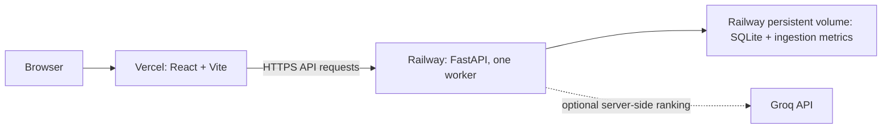

# DineGenie Deployment Plan and Notes: Railway API + Vercel Web

## Goal

Deploy the current React/Vite frontend to Vercel and the FastAPI recommendation API to Railway. Keep the two services on the same GitHub `main` revision, preserve the SQLite dataset across Railway deploys, and verify the live browser-to-API search before sharing the site.

This document began as a deployment plan and now also records platform settings and troubleshooting notes from the deployment. Live status below is based on the user's report and has not been independently checked from the platform dashboards.

## Current project shape



- The web client is `apps/web`; its production build is `dist`.
- The API entry point is `apps/api/app/main.py`. It is a FastAPI application, not a Streamlit app.
- The API serves recommendations from a SQLite database. Readiness is reported by `/health/ready` only when an active dataset can be read.
- `runtime-data/` and the SQLite database are ignored by Git. A Railway deployment will not receive the local database just by connecting GitHub.
- `VITE_API_BASE_URL` is compiled into the frontend at build time. The frontend must receive the public Railway API URL as a Vercel environment variable and be rebuilt when it changes.
- The supported release shape uses one SQLite writer. Do not scale the Railway API to multiple replicas or workers without replacing or redesigning the database and rate-limiting approach.

## Deployment notes captured during setup

### User-reported live configuration (2026-10-10)

- Railway API: `https://dinegenie-production.up.railway.app`
- Vercel frontend: `https://dinegenie-sooty.vercel.app`
- The user reports the app is deployed, the Vercel origin was added to Railway CORS, and Railway was redeployed.
- Production CORS origin: `https://dinegenie-sooty.vercel.app` (no trailing slash).
- Vercel's `VITE_API_BASE_URL` should be `https://dinegenie-production.up.railway.app` (no trailing slash).
- CORS is enforced by the Railway API. A Railway CORS change requires a Railway redeploy and a browser refresh; it does not require a Vercel redeploy. Redeploy Vercel when frontend code or `VITE_API_BASE_URL` changes, because Vite embeds that value at build time.
- After a database or environment change, verify Railway `/health/ready`, `/api/v1/metadata/locations`, and a search from the Vercel site. The user reported deployment completion; these checks are the operational verification steps.

### Railway build and dataset incidents

- The first Railpack build failed because uv could not find Python `3.12.*` while managed Python downloads were disabled. The root `.python-version` was pushed with `3.12.14`; Railway then reported a successful deployment.
- The first `/health/ready` check returned `DATASET_UNAVAILABLE` because the newly mounted volume contained an empty, zero-byte SQLite database. The database URL can be syntactically correct while the dataset has not yet been seeded.
- The Railway shell reported `/data` as 434 MB total with 424 MB free. The pinned `zomato.csv` is 574,072,999 bytes, so it cannot be downloaded onto that volume even when the volume is otherwise empty. The resulting `OSError: [Errno 28] No space left on device` is a capacity mismatch, not a bad database URL.

### One-time ingestion with a small persistent volume

The CLI uses one `--runtime-root` for the raw download, generated artifacts, SQLite database, and default metrics file. Keep the persistent volume for the serving database and metrics; stage the large download and intermediate artifacts on temporary disk. Check available temporary storage first with `df -h / /tmp`; the temporary filesystem must have enough room for the source and processing outputs. Temporary files do not survive a container replacement.

From `/app`, run the pinned ingestion with a temporary runtime root and write the metrics directly to the volume:

```sh
mkdir -p /tmp/dinegenie-seed
./.venv/bin/python -m pipelines.cli \
  --mode huggingface \
  --repository ManikaSaini/zomato-restaurant-recommendation \
  --revision 5738e9eda2fad49ad51c6e0ed26e761d9b947133 \
  --filename zomato.csv \
  --runtime-root /tmp/dinegenie-seed \
  --metrics-file /data/metrics/ingestion.prom
```

After ingestion succeeds, copy the completed database to the persistent volume using SQLite's backup API (this includes any committed WAL data):

```sh
./.venv/bin/python -c 'import sqlite3; s=sqlite3.connect("/tmp/dinegenie-seed/restaurants.db"); d=sqlite3.connect("/data/restaurants-seed.db"); s.backup(d); d.close(); s.close()'
./.venv/bin/python -c 'import sqlite3; c=sqlite3.connect("/data/restaurants-seed.db"); print(c.execute("PRAGMA integrity_check").fetchone()[0]); print(c.execute("SELECT COUNT(*) FROM restaurants").fetchone()[0]); c.close()'
```

The integrity check should print `ok` and the restaurant count should be nonzero (the pinned validation snapshot contained 12,372 canonical restaurants). Set Railway `APP_DATABASE_URL` to match the actual seeded filename—for the example above, `sqlite:////data/restaurants-seed.db`—then redeploy Railway and confirm `/health/ready` returns HTTP 200. If `/tmp` lacks enough space, run the one-time ingestion on a machine with sufficient disk and transfer only the validated SQLite database to the volume. Do not point the serving API at the temporary staging directory.

The user reports that the storage workaround is sorted. Confirm the actual database filename and Railway variable in the dashboard if repeating the procedure; the service may instead be using `/data/restaurants.db`.

## Release gates

Resolve these before making a public deployment available:

1. **Dataset rights:** Obtain and record permission for public hosting and use of the selected restaurant dataset, or replace it with data that is cleared for this use. The source license is currently unspecified. Until this is resolved, use only a dataset that is approved for the intended audience and exposure; do not publish the existing dataset by default.
2. **Metrics access:** Staging and production now require a bearer token for `/metrics`; configure the same strong token in Railway and the protected Prometheus secret file, then verify anonymous requests are rejected. Do not expose the token in source control, URLs, or logs.
3. **Proxy and client identity:** The API's rate limiter uses the client address seen by Uvicorn. Confirm that Railway's trusted proxy headers preserve the real caller address and cannot be spoofed. If they do not, enforce per-client limits at a trusted edge or update the API's trusted-proxy configuration before enabling public traffic.
4. **GitHub revision:** Confirm `main` contains the intended latest frontend and API code. Railway and Vercel deploy the pushed branch, not uncommitted local files.

## Phase 1: Prepare the repository and release settings

- Confirm the latest DineGenie frontend is committed and pushed to the GitHub repository connected to both platforms.
- Keep API, frontend, and data changes associated with a recorded Git commit so a release can be rolled back to a known revision.
- Review the production dependency lock (`uv.lock`) and frontend lock (`apps/web/package-lock.json`). Do not commit `.env`, API credentials, or the local database.
- Choose the production Vercel hostname first (for example, the assigned `*.vercel.app` hostname or a custom domain). Record the exact HTTPS origin; the API uses an explicit CORS origin allowlist.
- Decide which cleared dataset will be used and record its source, revision, license/permission, expected row count, and ingestion report.

## Phase 2: Create and configure the Railway API service

Create a Railway project from the DineGenie GitHub repository and add one service for the API.

**Service settings**

| Setting | Value |
|---|---|
| Source | DineGenie GitHub repository, production branch `main` |
| Root directory | Repository root (`/`) |
| Builder | Railpack/native Python build, configured in root `railway.toml`; do not select `apps/web` or the API Dockerfile |
| Build command | `uv sync --frozen --no-dev` (`railway.toml`) |
| Configuration file | Root `railway.toml` supplies native build/start commands, one worker, and restart policy |
| Health check path | Set `/health/live` during database initialization, then `/health/ready` in Railway service settings |
| Replicas/workers | One Railway replica and one Uvicorn worker |
| Persistent volume | Attach a Railway volume mounted at `/data` |

Check Railway's build logs for Python 3.12 and a successful locked dependency install. If Railpack does not select Python 3.12 from the project's `requires-python`/lock metadata, set the service's Python version explicitly before proceeding.

If running ingestion directly with `--runtime-root /data`, the volume must fit the pinned source download (about 574 MB), artifacts, SQLite/WAL files, and backups. A 434 MB volume cannot fit the source; use the small-volume staging procedure above or allocate more storage. `--proxy-headers` alone does not establish a trusted client address: configure Uvicorn's `--forwarded-allow-ips` only with Railway-documented trusted proxy addresses, or move rate limiting to a trusted edge. Do not trust arbitrary forwarded headers from the public Internet.

**Set Railway variables**

Set these in Railway's service variable UI, not in the Git repository:

```text
APP_ENVIRONMENT=production
APP_LOG_LEVEL=INFO
APP_DATABASE_URL=sqlite:////data/restaurants.db
APP_DATABASE_BUSY_TIMEOUT_SECONDS=5
APP_CORS_ORIGINS=https://<exact-production-vercel-origin>
APP_RATE_LIMIT_ENABLED=true
APP_METRICS_ENABLED=true
APP_METRICS_AUTH_TOKEN=<random-secret-at-least-32-characters>
APP_INGESTION_METRICS_FILE=/data/metrics/ingestion.prom
APP_LLM_ENABLED=false
RAILWAY_TRUSTED_PROXY_IPS=<Railway-documented-proxy-IP-or-CIDR-list>
```

Railway supplies `PORT`; `railway.toml` binds Uvicorn to it. Add only exact HTTPS frontend origins to `APP_CORS_ORIGINS`, separated by commas. Do not use `*`. For browser testing of previews, use a stable preview hostname and allowlist that exact origin, or test after promoting the frontend to its production hostname. Do not put a Groq key in Vercel or in a `VITE_` variable. Generate a high-entropy metrics token and use it only in Railway and the protected Prometheus secret file.

Keep model ranking disabled for the first deterministic deployment. After that release is healthy, optional AI ranking can be enabled by setting `APP_LLM_PROVIDER=groq`, an account-supported `APP_LLM_MODEL`, and `APP_GROQ_API_KEY` as a Railway secret, then exercising both AI and forced-fallback behavior. Confirm model availability, quotas, latency, and expected cost before enabling it for public traffic.

**Initialize the persistent database**

The volume must contain the validated SQLite serving database at `/data/restaurants.db` before the service is considered ready. Do not assume Railway's build or pre-deploy phase writes to the mounted runtime volume.

1. Deploy the service with the `/data` volume mounted and the temporary liveness check at `/health/live`. Do not announce or link the service while the dataset is uninitialized.
2. In a Railway shell/SSH session attached to this same service instance and volume, run the pinned ingestion once:

   ```sh
   ./.venv/bin/python -m pipelines.cli \
     --mode huggingface \
     --repository ManikaSaini/zomato-restaurant-recommendation \
     --revision 5738e9eda2fad49ad51c6e0ed26e761d9b947133 \
     --filename zomato.csv \
     --runtime-root /data
   ```

   Use this source only after its license is cleared. If using another source, update the source arguments to its approved immutable revision and validate the resulting manifest, row count, rejected-row report, and schema before activating it.
3. Confirm `/data/restaurants.db` and `/data/metrics/ingestion.prom` exist. Run the repository's SQLite integrity check against the mounted database and confirm its active dataset version.
4. Set the Railway health check to `/health/ready`. It must return HTTP 200 and the expected dataset version after a new deployment using the same volume.
5. Preserve a backup before future dataset refreshes. Stop or quiesce the one API writer while replacing/restoring the database, then recheck readiness.

If the account's Railway shell cannot access the service volume, stop here and select a supported one-time seed method that writes to this same persistent volume. Do not copy a database into the image filesystem and assume it will survive a deploy or volume mount.

Once the API is ready, generate its Railway public HTTPS domain. Test `/health/live`, `/health/ready`, `/api/v1/metadata/locations`, and one recommendation request against that domain. Check allowed and disallowed browser `Origin` behavior, request limits, trusted proxy identity, and the metrics access gate before linking the frontend.

## Phase 3: Deploy the web client to Vercel

Import the same GitHub repository into Vercel and create a Vercel project for the web client.

| Setting | Value |
|---|---|
| Production branch | `main` |
| Root directory | `apps/web` |
| Framework preset | Vite (also recorded in `apps/web/vercel.json`) |
| Node.js version | 22.x (`apps/web/package.json` requires Node 22) |
| Install command | `npm ci` (`apps/web/vercel.json`) |
| Build command | `npm run build` (`apps/web/vercel.json`) |
| Output directory | `dist` (`apps/web/vercel.json`) |

Add this Vercel **Production** environment variable, using the actual Railway HTTPS origin and no trailing slash:

```text
VITE_API_BASE_URL=https://<railway-api-domain>
```

For the user-reported deployment, the value is `https://dinegenie-production.up.railway.app`.

This value is public client configuration, not a secret. Set it for Preview only when the API CORS allowlist includes the exact preview origin. Save the settings and trigger a fresh Vercel production deployment so Vite embeds the new API origin in the build. Do not add `APP_GROQ_API_KEY` or any backend-only credential to Vercel.

## Phase 4: Verify the live application end to end

- Open the deployed Vercel site and confirm initial metadata loads from Railway.
- Run a representative search using a valid Bengaluru locality, budget band, and cuisine. Confirm results render with ratings, costs, and grounded explanations.
- Change filters and submit again. Confirm the result set reflects the revised request; try a no-match combination and verify the refinement flow works.
- Inspect browser developer tools for failed requests, CORS errors, mixed-content warnings, or secrets in frontend assets. Requests should go to the expected Railway HTTPS domain.
- Confirm Railway `/health/live` and `/health/ready` remain healthy and that API logs identify errors without logging user preference text or credentials.
- Verify `/metrics` is inaccessible to an unauthenticated public request and remains available only to the approved monitoring path.
- Verify the production API returns a 429 at the configured limit during a controlled test and does not apply one shared quota to unrelated users because of proxy address handling.
- If AI is enabled later, verify one assisted result and one forced provider-failure fallback. Confirm deterministic recommendations still work when Groq is unavailable.
- Test a Vercel redeploy and Railway redeploy independently. Confirm the volume retains the same active dataset and the frontend still reaches the API.

## Phase 5: Cut over and operate

- Attach any custom domain to Vercel and complete its HTTPS verification. Add that exact origin to Railway's CORS allowlist and redeploy the API.
- Keep Railway's database volume attached to the single API service. Do not use multiple SQLite writers, replicas, or workers.
- Set up a protected monitoring route for Prometheus metrics and configure the relevant Railway/Vercel service logs and alerts. Avoid exposing `/metrics` as an unrestricted public endpoint.
- Record the Git commit, dataset/source revision, active dataset version, API build, Vercel deployment URL, environment changes, and verification results for each release.
- Use Railway's previous successful deployment and Vercel's previous deployment for application rollback. Treat application rollback and database rollback as separate actions. Back up the SQLite volume before any migration or dataset activation; restore only through the documented guarded SQLite procedure while the API writer is stopped.
- Limit automatic production deploys to reviewed commits on `main`. Use previews/staging for frontend and API changes, and keep their data and secrets separate from production.

## Go-live checklist

- [ ] Latest intended frontend and API commit is pushed to GitHub `main`.
- [ ] Dataset redistribution/hosting permission is recorded, or a cleared replacement is active.
- [ ] Railway build succeeds with the locked Python environment.
- [ ] Railway has one worker, one replica, and a persistent `/data` volume.
- [ ] The active database on the volume passes integrity and readiness checks.
- [ ] Production CORS allows only the intended Vercel origin(s).
- [ ] Railway proxy headers and API rate-limit identity have been verified.
- [ ] Public `/metrics` access is restricted.
- [ ] Vercel builds the `apps/web` project and embeds the Railway API origin.
- [ ] The production browser search, filtering, refinement, and error paths work end to end.
- [ ] Backup and rollback procedures are recorded and a volume backup exists.
- [ ] If AI is enabled, the Railway-only secret, quota, fallback, and cost checks are complete.

The deployment is ready to be called public only after the data-rights and public metrics gates are resolved and every applicable go-live item above is checked.
